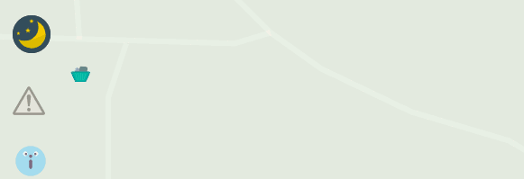
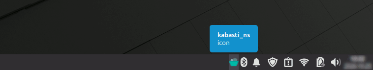

# Platform Specifics / Платформске спецефичности / Platformske specifičnosti  / Platformfüggő sajátosságok / Platformové špecifiká

Select your language / Изаберите језик / Izaberite jezik / Válasszon nyelvet / Vyberte si jazyk:
* [🇷🇸 Српски (Ћирилица)](#српски-ћирилица)
* [🇷🇸 Srpski (Latinica)](#srpski-latinica)
* [🇭🇺 Magyar](#magyar)
* [🇸🇰 Slovak](#slovak)
* [🇬🇧 English](#english)

---

## Српски (Ћирилица)

У наставку су детаљније описане карактеристике и разлике у односу на типове инсталација **Kabasti-NS** апликације.

### 🚨 Подестници - генерално, за све типове важи исто правило и активирају се на следећи начин:

<p align="center">
  <picture>
    <source media="(prefers-color-scheme: dark)" srcset="images/NS_reminders_dark.gif">
    <source media="(prefers-color-scheme: light)" srcset="images/NS_reminders_light.gif">
    
  </picture>
</p>

### 🪟 Windows инсталација

За разилку од MS Store инсталације, `Kabasti-NS.exe` са овог репозиторијума из системске касете контролише Подсетнике и Обавештења.

<p align="center">
    
</p>

Пошто је апликација нова и независна, постоји могућност да ће у току инсталације Windows приказати плави **SmartScreen** прозор.

Кликните на **"More info"** (Додатне информације), а затим на дугме **"Run anyway"** (Покрени ипак).

### 🐧 Linux инсталација

Било који тип Kabasti-NS Linux инсталације такође из системске касете контролише Подсетнике и Обавештења.

Ако користите **AppImage**, десним кликом идите на **Properties** -> **Permissions** и штиклирајте **"Allow executing file as program"**.

Деинсталација се може извршит из Terminal-а следећим командама:  
Debian-базирани Linux
```bash
dpkg -l | grep kabasti-ns

# само деинсталција
sudo apt remove kabasti-ns

# деинсталација са брисањем конфигурације
sudo apt purge kabasti-ns

# брисање свих преосталих зависних пакета креираних током инсталације 
sudo apt autoremove

```
`Познате грешке:` Након надоградње оперативног система, аутостарт функција може бити деактивирана, те је потребно апликацију ручно покренути како би се она поново активирала (проверити системку касету).

### 💻 macOS инсталација

У току је припреме!

<div align="center">
  <a href="https://github.com/cvekiboy/Kabasti-NS/releases/latest">
    <kbd>🔙 Назад на Realase</kbd>
  </a>
</div>

### 📱 Android инсталација

У сличају да нисте у могућности преузимања са Google Play-а, доступна је Вам је `Kabasti-NS.apk` датотека.

Пошто је апликација нова и независна, постоји могућност да ће Android приказати **Упозорење**.

> Да бисте заобишли ово упозорење, морате дати изричиту дозволу апликацији преко које сте преузели датотеку (нпр. Gооglе Chrome или Менаџер датотека).  
> Отворите Подешавања: Идите на почетни екран и отворите **Подешавања** (Settings).  
> Пронађите дозволу: Изаберите **Апликације** (Apps) -> **Посебан приступ апликацијама** (Special app access) -> **Инсталирање непознатих апликација** (Install unknown apps).  
> Изаберите извор: Додирните апликацију коју сте користили за преузимање (нпр. Chrome или Моје датотеке).  
> Дозволите инсталацију: Укључите прекидач поред опције **Дозволи из овог извора** (Allow from this source).  
> Покрените инсталацију: Вратите се на преузету .APK датотеку и поново покрените инсталацију.  

### 📱 iOS инсталација

У току је припреме!

---

## Srpski (Latinica)

У наставку су детаљније описане карактеристике и разлике у односу на типове инсталација **Kabasti-NS** апликације.

### 🚨 Подестници - генерално, за све типове важи исто правило и активирају се на следећи начин:

<p align="center">
  <picture>
    <source media="(prefers-color-scheme: dark)" srcset="images/NS_reminders_dark.gif">
    <source media="(prefers-color-scheme: light)" srcset="images/NS_reminders_light.gif">
    
  </picture>
</p>

### 🪟 Windows instalacija

Za razilku od MS Store instalacije, `Кabasti-NS.exe` sa ovog repozitorijuma iz sistemske kasete kontroliše Podsetnike i Obaveštenja.

<p align="center">
    
</p>

Pošto je aplikacija nova i nezavisna, postoji mogućnost da će Windows u toku instalacije prikazati plavi **SmartScreen** prozor.

Кliknite na **"More info"** (Dodatne informacije), a zatim na dugme **"Run anyway"** (Pokreni ipak).

### 🐧 Linux instalacija

Bilo koji tip Кabasti-NS Linux instalacije takođe iz sistemske kasete kontroliše Podsetnike i Obaveštenja.

Ako koristite **AppImage**, desnim klikom idite na **Properties** -> **Permissions** i štiklirajte **"Allow executing file as program"**.

Deinstalacija se može izvršit iz Terminal-a sledećim komandama:  
Debian-bazirani Linux
```bash
dpkg -l | grep kabasti-ns

# samo deinstalacija
sudo apt remove kabasti-ns

# deinstalacija sa brisanjem konfiguracije
sudo apt purge kabasti-ns

# brisanje svih preostalih zavisnih paketa kreiranih tokom instalacije
sudo apt autoremove

```
`Poznate greške:` Nakon nadogradnje operativnog sistema, autostart funkcija može biti deaktivirana, te je potrebno aplikaciju ručno pokrenuti kako bi se ona ponovo aktivirala (proveriti sistemku kasetu).

### 💻 macOS instalacija

U toku je pripreme!

### 📱 Android instalacija

U sličaju da niste u mogućnosti preuzimanja sa Google Play-a, dostupna je Vam je `Кabasti-NS.apk` datoteka.

Pošto je aplikacija nova i nezavisna, postoji mogućnost da će Android prikazati **Upozorenje**.

> Da biste zaobišli ovo upozorenje, morate dati izričitu dozvolu aplikaciji preko koje ste preuzeli datoteku (npr. Google Chrome ili Menadžer datoteka).  
> Otvorite Podešavanja: Idite na početni ekran i otvorite **Podešavanja** (Settings).  
> Pronađite dozvolu: Izaberite **Aplikacije** (Apps) -> **Poseban pristup aplikacijama** (Special app access) -> **Instaliranje nepoznatih aplikacija** (Install unknown apps).  
> Izaberite izvor: Dodirnite aplikaciju koju ste koristili za preuzimanje (npr. Chrome ili Moje datoteke).  
> Dozvolite instalaciju: Uključite prekidač pored opcije **Dozvoli iz ovog izvora** (Allow from this source).  
> Pokrenite instalaciju: Vratite se na preuzetu .APK datoteku i ponovo pokrenite instalaciju.  

### 📱 iOS instalacija

U toku je pripreme!

<div align="center">
  <a href="https://github.com/cvekiboy/Kabasti-NS/releases/latest">
    <kbd>🔙 Nazad na Realase</kbd>
  </a>
</div>

---

## Magyar

Az alábbiakban részletesen bemutatjuk a **Kabasti-NS** különböző telepítési típusainak sajátosságait és eltéréseit.

### 🚨 Emlékeztetők – általában minden típusra ugyanaz a szabály vonatkozik, és a következő módon aktiválhatók:

<p align="center">
  <picture>
    <source media="(prefers-color-scheme: dark)" srcset="images/NS_reminders_dark.gif">
    <source media="(prefers-color-scheme: light)" srcset="images/NS_reminders_light.gif">
    
  </picture>
</p>

### 🪟 Windows telepítés

Az MS Store-telepítéstől eltérően a `Kabasti-NS.exe` ezen adattárból származó verziója a tálca (értesítési terület) ikonjáról vezérli az Emlékeztetőket és az Értesítéseket.

<p align="center">
    
</p>

Mivel az alkalmazás új és független, a telepítés során előfordulhat, hogy a Windows megjelenít egy kék **SmartScreen** ablakot.

Kattintson a **"További információk"** (More info) elemre, majd a **"Futtatás mindenképpen"** (Run anyway) gombra.

### 🐧 Linux telepítés

A Kabasti-NS bármilyen Linux-telepítési típusa szintén a tálcáról (értesítési területről) vezérli az Emlékeztetőket és az Értesítéseket.

Ha **AppImage** formátumot használ, kattintson a jobb gombbal a **Properties** -> **Permissions** menüpontra, és pipálja be az **"Allow executing file as program"** opciót.

Az eltávolítás a terminálból a következő parancsokkal végezhető el:  
Debian-alapú Linux
```bash
dpkg -l | grep kabasti-ns

# csak eltávolítás
sudo apt remove kabasti-ns

# eltávolítás a konfiguráció törlésével
sudo apt purge kabasti-ns

# a telepítés során létrehozott összes fennmaradó függő csomag törlése
sudo apt autoremove

```
`Ismert problémák:` Az operációs rendszer frissítése után az automatikus indítás (autostart) funkció deaktiválódhat, ezért az alkalmazást manuálisan kell elindítani az újbóli aktiváláshoz (ellenőrizze a tálcát).

### 💻 macOS telepítés

Előkészület alatt!

### 📱 Android telepítés

Abban az esetben, ha nem tudja letölteni a Google Play áruházból, a `Kabasti-NS.apk` fájl is rendelkezésére áll.

Mivel az alkalmazás új és független, előfordulhat, hogy az Android **Figyelmeztetést** jelenít meg.

> Az figyelmeztetés megkerüléséhez kifejezett engedélyt kell adnia annak az alkalmazásnak, amelyen keresztül letöltötte a fájlt (pl. Google Chrome vagy Fájlkezelő).  
> Nyissa meg a Beállításokat: Lépjen a kezdőképernyőre, és nyissa meg a **Beállításokat** (Settings).  
> Keresse meg az engedélyt: Válassza az **Alkalmazások** (Apps) -> **Különleges alkalmazás-hozzáférés** (Special app access) -> **Ismeretlen alkalmazások telepítése** (Install unknown apps) lehetőséget.  
> Válassza ki a forrást: Érintse meg azt az alkalmazást, amelyet a letöltéshez használt (pl. Chrome vagy Fájlok).  
> Engedélyezze a telepítést: Kapcsolja be az **Engedélyezés ebből a forrásból** (Allow from this source) opció melletti kapcsolót.  
> Indítsa el a telepítést: Térjen vissza a letöltött .APK fájlhoz, és indítsa el újra a telepítést.  

### 📱 iOS telepítés

Előkészület alatt!

<div align="center">
  <a href="https://github.com/cvekiboy/Kabasti-NS/releases/latest">
    <kbd>🔙 Vissza a Realase</kbd>
  </a>
</div>

---

## Slovak

Nižšie sú podrobnejšie popísané charakteristiky a rozdiely medzi jednotlivými typmi inštalácie aplikácie **Kabasti-NS**.

### 🚨 Pripomienky – vo všeobecnosti platí pre všetky typy rovnaké pravidlo a aktivujú sa nasledujúcim spôsobom:

<p align="center">
  <picture>
    <source media="(prefers-color-scheme: dark)" srcset="images/NS_reminders_dark.gif">
    <source media="(prefers-color-scheme: light)" srcset="images/NS_reminders_light.gif">
    
  </picture>
</p>

### 🪟 Windows inštalácia

Na rozdiel od inštalácie z MS Store, `Kabasti-NS.exe` z tohto repozitára ovláda Pripomienky a Upozornenia z oznamovacej oblasti (systémovej lišty).

<p align="center">
    
</p>

Keďže ide o novú a nezávislú aplikáciu, počas inštalácie môže systém Windows zobrazíť modré okno **SmartScreen**.

Kliknite na položku **„Ďalšie informácie“** (More info) a potom na tlačidlo **„Napriek tomu spustiť“** (Run anyway).

### 🐧 Linux inštalácia

Akékoľvek typy inštalácie Kabasti-NS pre Linux tiež ovládajú Pripomienky a Upozornenia z oznamovacej oblasti (systémovej lišty).

Ak používate **AppImage**, kliknite pravým tlačidlom myši na **Properties** -> **Permissions** a začiarknite možnosť **"Allow executing file as program"**.

Odinštalovanie je možné vykonať z terminálu nasledujúcimi príkazmi:  
Linux založený na Debiane
```bash
dpkg -l | grep kabasti-ns

# len odinštalovanie
sudo apt remove kabasti-ns

# odinštalovanie s vymazaním konfigurácie
sudo apt purge kabasti-ns

# odstránenie všetkých zostávajúcich závislých balíkov vytvorených počas inštalacije 
sudo apt autoremove

```
`Známe problémy:` Po aktualizácii operačného systému môže byť funkcia automatického spustenia (autostart) deaktivovaná, preto je potrebné aplikáciu manuálne spustiť, aby sa opätovne aktivovala (skontrolujte systémovú lištu / oznamovaciu oblasť).

### 💻 macOS inštalácia

Prebieha príprava!

### 📱 Android inštalácia

V prípade, že nemáte možnosť stiahnuť si aplikáciu z Google Play, je vám k dispozícii súbor `Kabasti-NS.apk`.

Keďže ide o novú a nezávislú aplikáciu, existuje možnosť, že systém Android zobrazí **Upozornenie**.

> Aby ste obišli toto upozornenie, musíte udeliť výslovné povolenie aplikácii, cez ktorú ste súbor stiahli (napr. Google Chrome alebo Správca súborov).  
> Otvorte Nastavenia: Prejdite na domovskú obrazovku a otvorte **Nastavenia** (Settings).  
> Nájdite povolenie: Vyberte **Aplikácie** (Apps) -> **Špeciálny prístup k aplikáciám** (Special app access) -> **Inštalácia neznámych aplikácií** (Install unknown apps).  
> Vyberte zdroj: Klepnite na aplikáciu, ktorú ste použili na stiahnutie (napr. Chrome alebo Súbory).  
> Povoliť inštaláciu: Zapnite prepínač vedľa možnosti **Povoliť z tohto zdroja** (Allow from this source).  
> Spustite inštaláciu: Vráťte sa k stiahnutému súboru .APK a inštaláciu spustite znova.  

### 📱 iOS inštalácia

Prebieha príprava!

<div align="center">
  <a href="https://github.com/cvekiboy/Kabasti-NS/releases/latest">
    <kbd>🔙 Späť na Realase</kbd>
  </a>
</div>

---

## English

Below is a detailed description of the characteristics and differences between the installation types of the **Kabasti-NS** application.

### 🚨 Reminders – generally speaking, the same rule applies to all types, and they are activated as follows:

<p align="center">
  <picture>
    <source media="(prefers-color-scheme: dark)" srcset="images/NS_reminders_dark.gif">
    <source media="(prefers-color-scheme: light)" srcset="images/NS_reminders_light.gif">
    
  </picture>
</p>

### 🪟 Windows Installation

Unlike the MS Store installation, `Kabasti-NS.exe` from this repository controls Reminders and Notifications from the system tray.

<p align="center">
    
</p>

Since the application is new and independent, during the installation, Windows may display a blue **SmartScreen** window.

Click on **"More info"**, and then click the **"Run anyway"** button.

### 🐧 Linux Installation

Any type of Kabasti-NS Linux installation also controls Reminders and Notifications from the system tray.

If you are using **AppImage**, right-click, go to **Properties** -> **Permissions**, and check **"Allow executing file as program"**.

Uninstallation can be performed from the Terminal using the following commands:  
Debian-based Linux
```bash
dpkg -l | grep kabasti-ns

# uninstall only
sudo apt remove kabasti-ns

# uninstallation with configuration deletion
sudo apt purge kabasti-ns

# removal of all remaining dependency packages created during installation 
sudo apt autoremove

```
`Known Issues:` Following an OS upgrade, autostart may become disabled, requiring you to manually start the application to reactivate it (check the system tray).

### 💻 macOS Installation

In preparation!

### 📱 Android Installation

In case you are unable to download it from Google Play, the `Kabasti-NS.apk` file is available to you.

Since the application is new and independent, Android may display a **Warning**.

> To bypass this warning, you must grant explicit permission to the app that is initiating the installation (like Google Chrome or your File Manager).  
> Open Settings: Go to your device's **Settings** menu.  
> Find the Permission: Search for or navigate to **Apps** -> **Special app access** -> **Install unknown apps**.  
> Select the Source: Tap on the app you used to download the file (e.g., Chrome or Files by Google).  
> **Allow from this Source**: Toggle the switch to the ON position.  
> Install the App: Go back to the downloaded file and attempt the installation again.  

### 📱 iOS Installation

In preparation!

<div align="center">
  <a href="https://github.com/cvekiboy/Kabasti-NS/releases/latest">
    <kbd>🔙 Back to Realase</kbd>
  </a>
</div>
